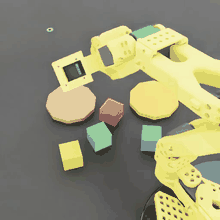
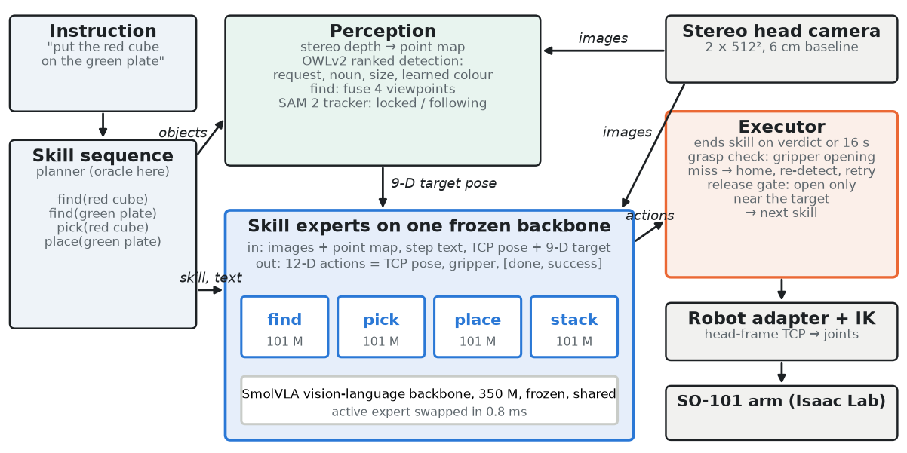
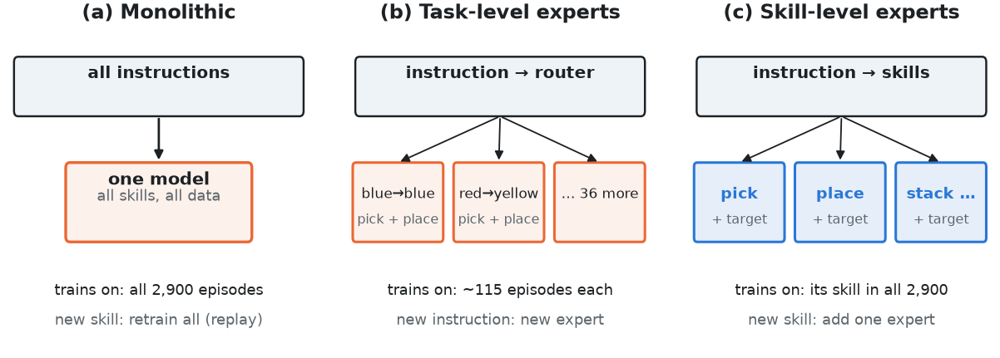
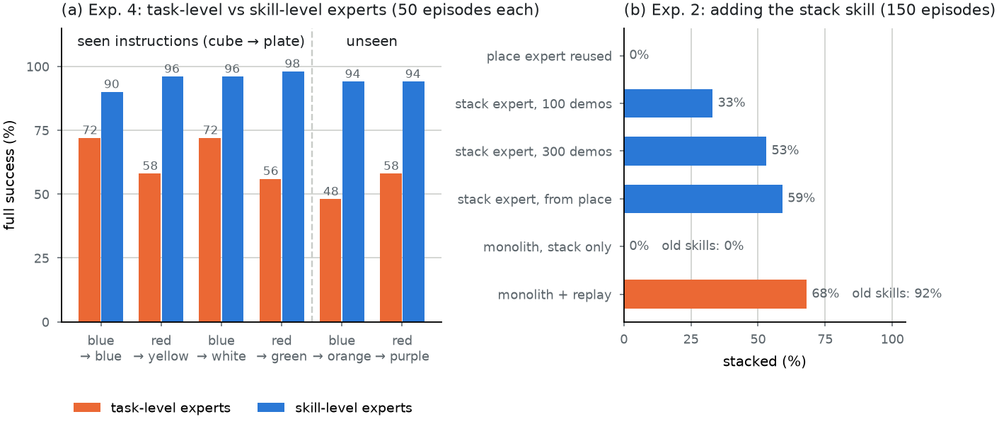
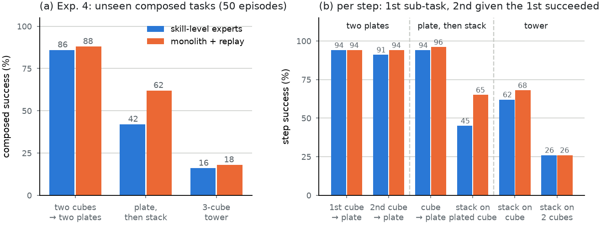

# Skill-based VLA training

**Skill-level experts with grounded targets for language-conditioned manipulation** on a 5-DoF SO-101 arm, built
and evaluated in simulation (Isaac Sim / Isaac Lab, one RTX 5080).

<p align="center">
  
  <br><em>"Put the blue cube on the orange plate, then stack the red cube on top of it": two skill sequences, no
  training episode of this task.</em>
</p>

A planner turns an instruction into a sequence of skills (`find`, `pick`, `place`, `stack`). Each skill is a small
expert on one shared, frozen vision-language-action (VLA) backbone, and each is told **which object to act on**
through a 3-D target pose from perception (open-vocabulary detection, stereo depth, SAM 2 tracking). An executor
ends skills on the expert's own pass/fail verdict, checks every grasp from the gripper opening and retries misses.

The research question: **at which granularity should VLA experts be defined: one model, one expert per task, or one
expert per skill?** A paper draft is in [`paper/`](paper/).

## Key results (simulation, seeded and paired evaluations)

| Question | Result |
|---|---|
| End-to-end pick-and-place (random plate colours, 150 episodes) | **91%** stationary, **87%** with the cube pushed mid-pick (from 45% / 22% after a failure-driven reliability study) |
| One model vs one expert per skill, same data and compute (Exp. 1) | No consistent difference (93% vs 91% stationary, 81% vs 87% pushed) |
| Expert per **task** vs per **skill**, same compute (Exp. 2) | Seen instructions **56–72% vs 90–98%**; unseen **48–58% vs 94%** (all p ≤ 0.02) |
| Adding a new skill (`stack`, 300 demos) (Exp. 3) | New skill expert: 53% (59% initialised from `place`), old skills untouched. Monolith fine-tuned on stack data: 0%, forgets everything; with replay of old data: 68%, keeps 92% |
| Unseen multi-step tasks (Exp. 4, 50 episodes each) | Two cubes onto two plates: 86% skills vs 88% monolith; plate then stack: 42% vs 62%; 3-cube tower: 16% vs 18%. Steps compose almost independently; stacking onto raised targets is the bottleneck for both |

Skill-level experts do not make individual skills better, but they let every expert learn from all the data and
transfer to new objects and instructions, and they make adding skills safe. Composed tasks succeed when their
skills do: composition itself added no failures. The largest end-to-end gains came from
executor mechanisms (grasp check + retry, release gate) and data labelling rather than from model changes.

<p align="center"></p>
<p align="center"></p>
<p align="center"></p>
<p align="center"></p>

## Example videos (left head camera)

| Video | Shows |
|---|---|
| [01_pick_place.mp4](media/videos/01_pick_place.mp4) | find → pick → place: "put the blue cube on the orange plate" |
| [02_push_grasp_check_retry.mp4](media/videos/02_push_grasp_check_retry.mp4) | The cube is pushed 56 mm during the pick; the grasp misses, the grasp check catches it, the retry succeeds |
| [03_stack_new_skill.mp4](media/videos/03_stack_new_skill.mp4) | The added `stack` skill: "stack the blue cube on the yellow cube" |
| [04_composed_two_cubes_two_plates.mp4](media/videos/04_composed_two_cubes_two_plates.mp4) | Unseen composed task: two cubes onto two plates |
| [05_composed_plate_then_stack.mp4](media/videos/05_composed_plate_then_stack.mp4) | Unseen composed task: a cube onto a plate, then a second cube stacked on it |
| [06_failure_late_push_no_reaim.mp4](media/videos/06_failure_late_push_no_reaim.mp4) | Failure case: the cube is pushed while the gripper hovers above it; the target updates, but the pick expert descends on schedule and misses (the grasp check then retries) |

## Repository layout

```
so101_lang/          library: skills and language, environment, scripted expert, robot adapter, data tools,
                     perception (stereo depth, OWLv2 ranked detection, learned colour model, SAM 2 tracker),
                     SmolVLA-with-depth policy plugin, policy / perception server
scripts/             data generation, evaluation (eval_policy.py, eval.sh), experiment drivers (run_exp*.sh),
                     figure / data tools
paper/               paper draft (main.tex, references.bib), figures/ (make_figures.py), data/ (per-episode results
                     of every run in the paper, summary.csv with paired sign tests, extract.py)
media/               README animation and example videos
docs/NOTES.md        full technical notebook: architecture, data, training, perception, evaluation, results log,
                     open work
docs/context/        working notes kept across sessions
hardware/            print files for a real setup (hardware/prints/): SO-101 gripper, stereo camera plate,
                     task cube and plate at simulation size
train/, tests/       training launchers, frame-maths tests
```

Datasets (~400 GB), checkpoints and full evaluation outputs are not in the repository.

## Running it

Two Python environments talk over a local socket: the simulator in `~/isaacsim` (Isaac Sim 6.1, Isaac Lab 3.0) and
the policy / perception server in `~/lerobot-env` (LeRobot 0.6.1, PyTorch, TensorRT).

```bash
# evaluate the current skill models: 150 seeded stationary + 150 push episodes (starts and stops the server)
scripts/eval.sh still push
# one composed multi-step task type with the oracle skill sequence
CK_STACK=stack9_place300_5000 EPISODES=50 EVAL_EXTRA="--compose plate_stack" scripts/eval.sh still
# data generation and training pipeline for the pick / place experts
scripts/run_stage_rc2.sh
```

See [`docs/NOTES.md`](docs/NOTES.md) for every component, data set, training recipe and result in detail.

## Status

Simulation only, one arm, one object family (cubes and plates). Experiments 1-4 are complete. Next: stacking at new
target heights, the LIBERO benchmark, and a small real-robot study. The LLM planner (Ollama `qwen3-vl:8b`) is implemented but not used in
the reported experiments.
